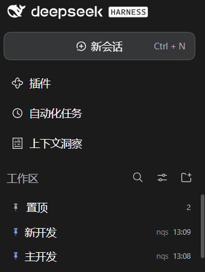

# dsh-pinned-panel

[](https://github.com/OuQiL/dsh-pinned-panel/tags)
[](LICENSE)
[](#环境要求)

> **在 [DeepSeek Harness](https://github.com/deepseek-ai/deepseek-harness) 侧边栏列表最上方加一个「置顶」分组。**
> 置顶的对话不再只是"在当前工作区里排到前面"：来自所有工作区的置顶对话集中成侧边栏列表里的**第一个分组**，默认展开；点开任意一条，**仍然回到它本来的工作区**继续。

[English](README.md) | 简体中文

<p align="center">
  
</p>

<p align="center"><em>「置顶」分组在会话列表最上方：两条来自同一工作区的置顶对话，点开仍各自回到原工作区。</em></p>

## 目录

- [效果](#效果)
- [安装](#安装)
- [环境要求](#环境要求)
- [工作原理](#工作原理)
- [与 dsh-pin 的对比](#与-dsh-pin-的对比)
- [常见问题 / 排障](#常见问题--排障)
- [安全与隐私](#安全与隐私)
- [已知边界](#已知边界)
- [开发](#开发)
- [参与贡献](#参与贡献)
- [许可](#许可)

## 效果

```
侧边栏
├─ 📌 置顶                       3      ← 列表第一个分组，默认展开
│   ├─ 🔧 修复登录失效            14:32
│   ├─ 📊 接口差异报告            昨天
│   └─ 📝 周报草稿                10-21
├─ 📁 default-workspace                 ← 原有的工作区分组，一行都没动
│   ├─ 会话 A
│   └─ 会话 B
└─ 📁 另一个工作区
```

- **列表最上方的「置顶」分组**：行高 32px、表头 34px、`--dsw-radius-md` 圆角、悬停/焦点环都照应用自己的会话行复刻，亮暗色随主题。
- **默认展开**，点表头可收起（选择记在 `localStorage` 里）。
- **点行 = 回到原工作区打开**：走官方 `uiWorkspace.openSession()`，和点侧边栏里那一行完全等价——工作目录、上下文、历史都不变。
- **不另存一份置顶状态**：分组直接读宿主的 `pinnedSessionIds` 与工作区归属；置顶 / 取消置顶仍然是应用原有的 📌 动作（本插件额外提供悬停 ✕）。
- **能看出来源**：每行右侧显示它所属的工作区，悬停显示完整标题。
- **原行保留**：置顶的对话在它原来的工作区分组里照常显示，置顶分组只是额外入口，不是"搬家"。
- **没有多余的页面/图标**：插件只加这一个分组，没有独立的置顶页，也没有图标栏入口。

## 安装

### 应用内安装（推荐）

1. 打开 **设置 → 插件**；
2. 点 **添加插件**；
3. 粘贴本仓库的 Git 地址：

   ```
   github:OuQiL/dsh-pinned-panel
   ```

   （对话框也接受完整的 `https://github.com/OuQiL/dsh-pinned-panel`、压缩包地址，或本地绝对路径）

4. 刷新页面。会话列表最上方出现「置顶」分组。

### 命令行安装

```bash
dsh plugin add github:OuQiL/dsh-pinned-panel
# 或显式指定 profile
dsh plugin --profile desktop add github:OuQiL/dsh-pinned-panel
```

### 从本地目录安装

```bash
git clone https://github.com/OuQiL/dsh-pinned-panel.git
dsh plugin add /absolute/path/to/dsh-pinned-panel
```

链接目录安装时，改完 `lib/client.js` 刷新页面（`Ctrl+R`）即可加载新 bundle，无需重装。

### 卸载

设置 → 插件 → *dsh-pinned-panel* → 停用/卸载；或 `dsh plugin remove dsh-pinned-panel`。

## 环境要求

| | |
|---|---|
| 界面 | DeepSeek Harness **Web GUI**（Desktop 应用渲染同一套 Web 界面） |
| 实测版本 | `0.2.1-rc.2` / Windows |
| Host 半边 | 无（空实现），全部在浏览器侧 |
| 凭据 / 网络 | 不需要 |
| 侧边栏 | 必需；TUI / headless profile 没有可挂载位置 |

插件依赖侧边栏列表的结构，若某次 DSH 升级重构了该列表，可能需要小幅适配（见[工作原理](#工作原理)）；届时插件会退化为"不显示分组"，不会弄坏应用本身。

## 工作原理

```
置顶状态（宿主）                     uiWorkspace 服务（应用自带）
  pinnedSessionIds  ────┐              openSession(id)  ──► 选中该会话并显示对话
  items[].sessionIds ───┴─► 置顶分组 ──► unpinSession(id) ──► 写回置顶集合
                              （侧边栏列表）      两者都是官方调用
```

应用的会话浏览器整块占用了**单个** `sidebar.workspaces` slot，插件无法往里插分组；替换整块浏览器又等于重写应用的会话列表，升级必坏。所以只做入侵最小的"顶部追加"：

1. 插件在侧边栏壳层里挂一个**不可见的座位**（`sidebar.footer.action`，也就是设置按钮旁边的一个空动作；座位本身渲染 `null`）；
2. 从这个座位自己的 DOM 节点向上找到浏览器的列表区域，再定位滚动容器；
3. 把一个宿主节点插入列表**第一个子节点**，用 React portal 渲染分组，并复用应用的分组 class 让间距规则生效；
4. `MutationObserver`（+ 慢速兜底轮询）在 React 重建列表后自动重新挂载。

只**插入**，不隐藏、不重排应用自己渲染的任何内容。

### 注入层的防御措施

- 锚点来自插件自己的节点，**不用**全局选择器盲猜；
- 按构建哈希 class 的**后缀**匹配（`*_listArea`、`*_list`、`*_groupSection`），换哈希不影响；
- 扁平列表（In one list）与搜索态自动不注入（那里没有工作区分组可依附）；
- 结构不符合预期时**什么都不做**，只在控制台打一行：
  `[dsh-pinned-panel] sidebar list seam not found; the Pinned group cannot be placed.`

另外：**portal 的事件冒泡走 React 树，不走 DOM 树**，所以注入分组自己做了 `stopPropagation()`，避免点击冒泡到座位所在的宿主组件上。

## 与 dsh-pin 的对比

[dsh-pin](https://github.com/Yu-tao-Li/dsh-pin) 是目前最接近的插件：两者都是纯客户端、都依附侧边栏列表、都复用应用自己的顺序与会话打开接口。区别在形态：

| | dsh-pinned-panel（本插件） | dsh-pin |
|---|---|---|
| 置顶出现在哪 | 会话列表**第一个分组** | 所有工作区组上方的**全局托盘**，外加组内置顶 |
| 原行 | 始终保留 | 全局置顶时可隐藏原行 |
| 置顶层级 | 一级（复用应用自己的置顶状态） | 两级（工作区置顶 + 全局置顶，自带记录） |
| 额外界面 | 无（无页面、无图标栏入口） | 托盘 + 每行置顶按钮 |
| 自己保存的状态 | 只有"收起/展开"偏好 | 每个置顶会话的 `localStorage` 记录 |
| 撤销 / 还原 | 应用自己的取消置顶 | 精确还原置顶前的位置 |

想要悬浮托盘 + 隐藏原行 → 用 dsh-pin；只想在列表里多一个分组、其余一概不加 → 用这个。

## 常见问题 / 排障

**分组没出现。**
打开浏览器控制台。如果看到
`[dsh-pinned-panel] sidebar list seam not found; the Pinned group cannot be placed.`，
说明你的 DSH 版本改动了侧边栏列表结构，注入层需要适配——请带这行日志和 DSH 版本提 issue。

**分组出现两次，或安装时报 `loaded without registering …`。**
说明还装着改名前的旧包名（`@local/dsh-pinned-panel`）。在 设置 → 插件 里卸载它，或重启应用；本插件的 bundle 同时注册新旧两个 id，残留旧包也不会再报错。

**点行总是停在同一条对话。**
`0.1.6` 已修；确认版本 ≥ `0.3.0`（控制台会打印 `[dsh-pinned-panel] active vX.Y.Z`）。

**怎么确认当前加载的版本？**
页面加载时的控制台那行，或 设置 → 插件 里的条目。

**需要配置什么吗？**
没有任何设置项。唯一保存的值是"收起/展开"，键名 `dsh-pinned-panel.sidebar.collapsed`。

**换浏览器还会有吗？**
置顶状态来自宿主，所以有；"收起/展开"偏好是每个浏览器各自的。

**在哪取消置顶？**
应用原有的 📌 动作（和以前一样），或分组行悬停出现的 ✕。

## 安全与隐私

- **不发起任何网络请求、无遥测、不碰凭据**。Host 半边是空的 `apply()`。
- **读取**：宿主的工作区 / 会话快照（标题、id、时间、工作区归属），也就是侧边栏本来就在显示的数据。
- **写入**：只有一个浏览器键 `localStorage['dsh-pinned-panel.sidebar.collapsed']`。置顶状态的变化是应用自己通过 `uiWorkspace` 完成的。
- **DOM**：只在侧边栏列表里插入一个宿主节点并用 React portal 渲染；不改动、不隐藏、不重排应用的其它内容。
- **样式**：一个随插件生命周期注册的内联 `<style>`，只使用 DSH 主题 token。

## 已知边界

- 列表分组是**显示层**追加：不改会话顺序、不写额外存储，应用自带"置顶在组内最前"的行为原样保留。
- 不属于任何工作区的置顶对话：混排在分组里，不显示来源标签。
- 组内按最近更新排序（新的在前）。
- 插件沿用应用的置顶语义，不新增自己的置顶存储，所以刷新、换浏览器都一致。
- 若 DSH 未来重构侧边栏浏览器，注入层可能需要适配（契约就是上面那几个 class 后缀）。

## 开发

```
package.json          bundle 清单：Host patch + 浏览器半边
cordis.patch.yml      插入一行 Host 插件（Host 半边为 no-op）
index.js              Host 半边：空 apply()
lib/client.js         浏览器 bundle：侧边栏座位、列表注入、置顶分组
locale/{zh,en}.json   插件管理里显示的名称与描述
icon.svg              原创建意图标
scripts/verify.mjs    本地自检（编码、JSON、清单、客户端模块）
scripts/ci-workflow-template.yml  可直接启用的 GitHub Actions 工作流
assets/               README 用的侧边栏分组截图
```

```bash
node scripts/verify.mjs     # 编码 + JSON + 清单 + 客户端模块
node --check lib/client.js  # 仅语法
```

没有构建步骤：`lib/client.js` 就是交付给客户端加载的浏览器模块
（`window.__ModuleLoader__.load({ id, factory })`），页面加载时直接读取。
它把同一个工厂同时注册到当前包名和改名前的 `@local/dsh-pinned-panel` 两个 id 上，
这样仍装着旧包的 profile 不会报 `loaded without registering …` 而加载失败；旧包卸载后第二个注册自然闲置。

版本历史见 [CHANGELOG.md](CHANGELOG.md)，里面记录了塑造当前实现的两个坑（portal 事件冒泡、UTF-8 BOM 导致 GitHub 安装失败）。

## 参与贡献

欢迎 issue 与 PR。

- 报 bug 请附 DSH 版本 + 所有以 `[dsh-pinned-panel]` 开头的控制台日志；
- 提 PR 前请跑 `node scripts/verify.mjs`；
- `scripts/ci-workflow-template.yml` 是同一套检查的 Actions 工作流，复制成 `.github/workflows/verify.yml` 即可启用（需要具备 workflow 权限的账号/token）；
- 涉及视觉行为的改动，请说明在哪个 DSH 版本上验证过。

## 许可

[MIT](LICENSE) © 2026 OuQiL

与 DeepSeek 官方无隶属关系；"DeepSeek Harness" 是本插件所扩展的宿主应用。
